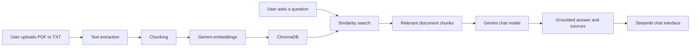

# Document Assistant

A beginner-friendly document question-answering application built with Python, Streamlit, Gemini, LangChain, PyPDF, and ChromaDB.

The application lets a user upload a technical PDF or text document and ask questions about its contents. Answers are generated from relevant chunks of the uploaded document instead of relying only on the language model's general knowledge.

## Features

- Upload PDF and TXT documents.
- Extract text from PDFs while preserving page numbers.
- Split long documents into searchable chunks.
- Create vector embeddings with Google's Gemini API.
- Store embeddings locally in ChromaDB.
- Retrieve the most relevant document chunks for each question.
- Generate grounded answers with Gemini.
- Maintain a chat conversation during the current session.
- Support follow-up questions using recent conversation context.
- Display source documents and PDF page numbers.
- Clear the current conversation from the sidebar.
- Warn the user when a question cannot be answered from the document context.

## Technology stack

| Technology | Responsibility |
| --- | --- |
| Python 3 | Main programming language |
| Streamlit | Web interface, file upload, and chat UI |
| Google Gemini API | Text embeddings and answer generation |
| `langchain-google-genai` | LangChain integration for Gemini |
| LangChain | Document splitting, prompts, and retrieval workflow |
| PyPDF | Extract text and page numbers from PDF files |
| ChromaDB | Local vector database for document chunks |
| `python-dotenv` | Load the Gemini API key from `.env` |

## Architecture



## How the application works

### 1. Upload and text extraction

The user uploads one PDF or TXT file. For PDFs, PyPDF reads each page individually and stores the filename and page number as metadata. TXT files are loaded as a single document.

### 2. Chunking

LangChain's `RecursiveCharacterTextSplitter` divides long text into overlapping chunks:

- Chunk size: 1,200 characters
- Chunk overlap: 200 characters

The overlap helps preserve context when a sentence falls across a chunk boundary.

### 3. Embeddings and vector storage

Each chunk is converted into a vector using Gemini's embedding model and stored in a local ChromaDB collection. Collections are identified by a hash of the uploaded file, so different uploads do not share the same document index.

The local database is stored in `.chroma/`, which is ignored by Git.

### 4. Retrieval and answer generation

For every question, ChromaDB returns the five most relevant chunks. Those chunks, the question, and recent conversation context are sent to Gemini. The model is instructed to use only the supplied context, cite available page numbers, and say when the answer cannot be found.

### 5. Chat display

Streamlit displays the user question, generated answer, and an expandable list of retrieved sources.

## Project structure

```text
ai-document-assistant/
├── app.py              # Main Streamlit application
├── requirements.txt    # Python dependencies
├── .env.example        # Safe environment-variable template
├── .gitignore          # Excludes secrets and local generated data
└── README.md           # Project documentation
```

Generated at runtime:

```text
.chroma/                # Local ChromaDB data
```

## Requirements

- Python 3.10 or newer
- A Google Gemini API key
- Internet access when calling the Gemini API

## Installation

From PowerShell:

```powershell
cd ai-document-assistant
python -m venv .venv
.\.venv\Scripts\Activate.ps1
pip install -r requirements.txt
```

If PowerShell blocks activation:

```powershell
Set-ExecutionPolicy -Scope CurrentUser RemoteSigned
```

## Configuration

Create a local `.env` file from the example:

```powershell
Copy-Item .env.example .env
notepad .env
```

Add your API key:

```env
GOOGLE_API_KEY=your_gemini_api_key_here
```

Never commit `.env` or your actual API key. The repository ignores `.env`, `.nv`, and `.chroma/`, while `.env.example` remains tracked as a setup template.

## Running the application

```powershell
streamlit run app.py
```

Open the local address shown by Streamlit, normally `http://localhost:8501`.

## Manual testing

1. Upload a PDF or TXT file containing known information.
2. Ask `Summarise this document.`
3. Ask a specific question whose answer appears on a known PDF page.
4. Check that the answer includes a relevant page citation.
5. Ask a follow-up question such as `Explain that in simpler terms.`
6. Ask about something not contained in the document.
7. Confirm that the assistant says it cannot find the answer instead of inventing one.
8. Upload a different file and confirm that the conversation and index reset.

Example questions:

- What are the main topics covered?
- Explain the authentication process.
- What does the document say about database security?
- Where does it discuss API integration?
- What are the key recommendations in section 3?

## Important implementation details

This is a retrieval-augmented generation (RAG) application. Gemini does not receive the entire document automatically. It receives the user's question, recent conversation context, and the most relevant chunks found by ChromaDB.

Streamlit session state stores the active vector store, file hash, filename, and visible conversation. This lasts for the current browser session; it is not an account system or permanent chat history.

## Limitations

- Scanned or image-only PDFs need OCR before their contents can be searched.
- Tables and complex PDF layouts may not extract perfectly with PyPDF.
- The application currently handles one active document at a time.
- Gemini API usage may incur costs.
- ChromaDB is local and is not configured as a shared production database.
- Source citations are based on retrieved metadata and should be verified against the original document.
- There are no automated unit or integration tests yet; the manual test flow above is the current validation method.

## Security and privacy

- Keep the Gemini API key in `.env`, never in source code.
- Do not commit private or confidential documents to the repository.
- Uploaded text is sent to the configured Gemini API for embedding and answer generation.
- The `.chroma/` directory may contain extracted document content, so treat it as sensitive.
- Production use should add authentication, file-size limits, access controls, logging policy, and a managed vector database.

## Troubleshooting

### `GOOGLE_API_KEY` warning

Confirm that `.env` exists beside `app.py` and contains a valid key. Restart Streamlit after changing it.

### No text found in the PDF

The PDF may contain scanned images instead of selectable text. Run OCR first or use a text-based PDF.

### Dependency installation fails

```powershell
python -m pip install --upgrade pip
pip install -r requirements.txt
```

### Reset the local document index

Stop Streamlit and remove only the generated `.chroma/` directory, then restart the application. It is safe to regenerate from uploaded files.

## Future improvements

- Support multiple documents in one knowledge base.
- Add OCR for scanned PDFs.
- Add document preview and clickable source excerpts.
- Add automated tests for extraction, chunking, retrieval, and prompt behavior.
- Add streaming responses.
- Add authentication and persistent user workspaces.
- Add configurable chunk size and retrieval count.
- Add production vector database and deployment configuration.
